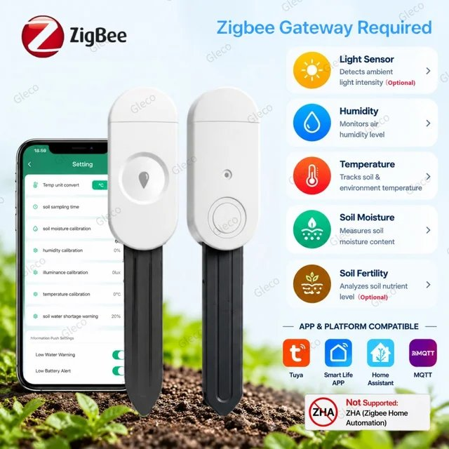
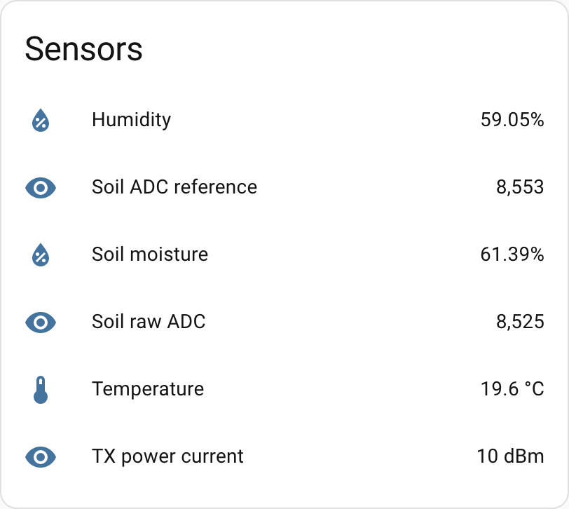
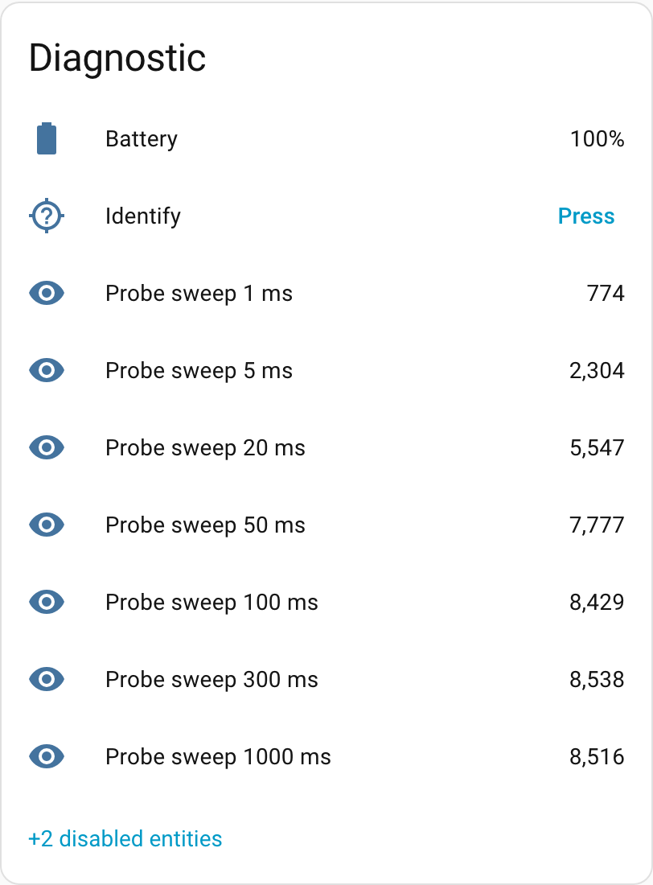
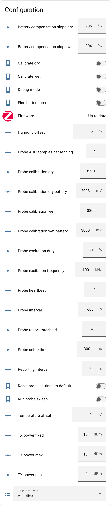
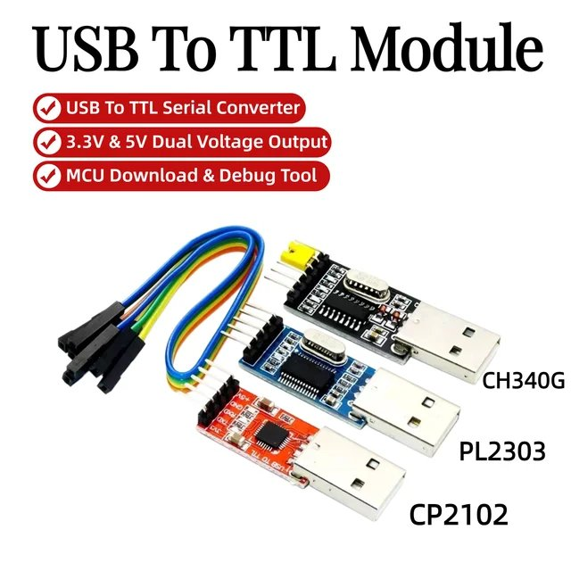
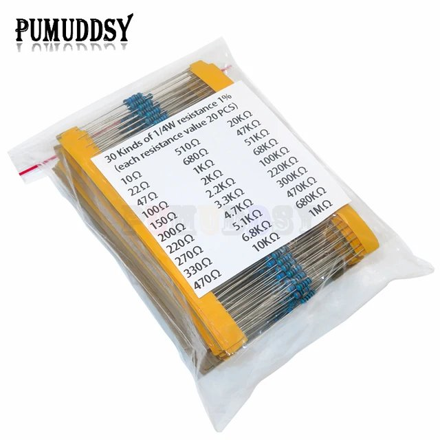
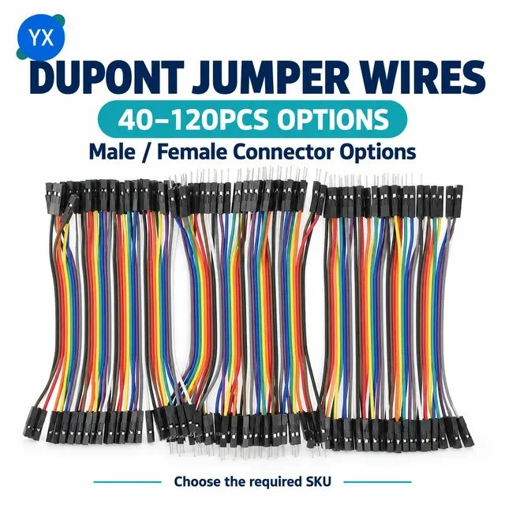
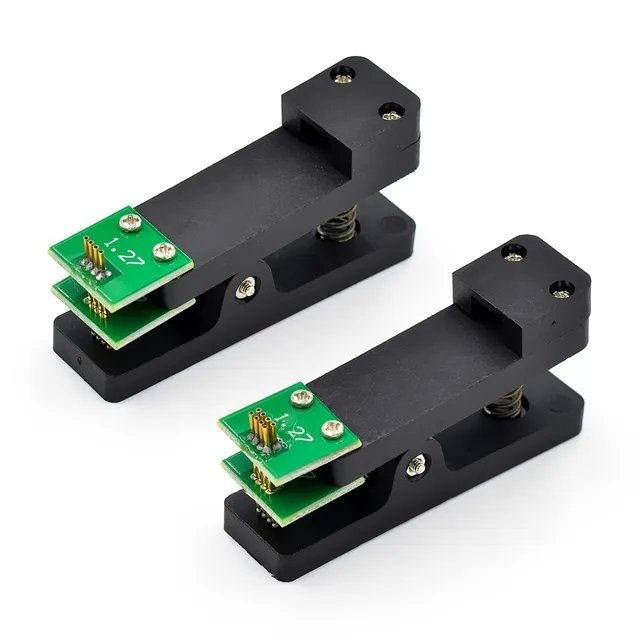
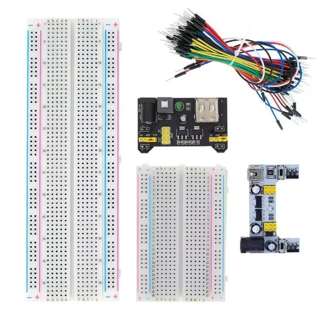

# Custom firmware for the Arteco ZS-304Z soil sensor

> Vibecoded project but verified on hardware

Zigbee firmware for the [Arteco ZS-304Z soil moisture sensor](https://s.click.aliexpress.com/e/_c3VsyyDL) (PCB ZSSF21), based on [Fortify](https://github.com/sweitzja/Fortify-Soil-Sensor-ZG-303Z) and [pvvx/ZigbeeTLc](https://github.com/pvvx/ZigbeeTLc), with a Home Assistant (ZHA) quirk.

The stock firmware turns the probe reading into a percentage clamped to 0–100 % with its own fixed curve, so information is lost and two sensors in the same soil can disagree strongly. This firmware reports the **raw probe value** and lets you decide:

- your own **dry/wet calibration** (one switch each in Home Assistant), with battery-voltage compensation
- a configurable **probe interval**, settle time and excitation; temperature and humidity keep their own interval
- **debug mode** (probe values every 500 ms) and a **probe sweep** to check settling
- **OTA updates** from Home Assistant after the first flash
- battery life estimated >10 years

## In Home Assistant

<table><tr><td valign="top" width="33%">  </td><td valign="top" width="33%"></td></tr></table>

## What I used to flash it

<table><tr><td align="center" width="20%"> <a href="https://s.click.aliexpress.com/e/_c3T1vwOV">USB-UART adapter</a> CH340, set to 3.3 V</td><td align="center" width="20%"> <a href="https://s.click.aliexpress.com/e/_c3o2QKSd">Resistors</a> 1 kΩ between TX and the SWire pad</td><td align="center" width="20%"> <a href="https://s.click.aliexpress.com/e/_c4W5qWTX">Jumper wires</a></td><td align="center" width="20%"> <a href="https://de.aliexpress.com/item/1005004869027755.html?channel=twinner">Clamp fixtures</a> hold contacts on the programming pads</td><td align="center" width="20%"> <a href="https://de.aliexpress.com/item/1005006143786009.html?channel=twinner">Breadboard</a></td></tr></table>

The product photos are local copies, in case the shop links stop working.

## How to do it

See **[INSTALLATION.md](INSTALLATION.md)**: wiring, backing up the stock firmware, building, flashing, Home Assistant setup, OTA updates and all settings. Hardware details are in [docs/HARDWARE.md](docs/HARDWARE.md).

## License

MIT, as the original Fortify firmware. SDK and source files keep their Telink notices.
